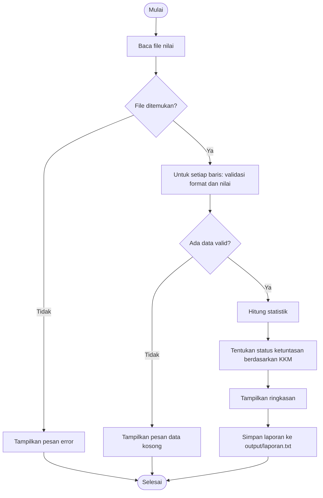

# Proposal Proyek Pertemuan 14: Program Rekap dan Analisis Nilai Matematika Kelas

| **Keterangan** | **Data** |
|---|---|
| **Nama** | Masya Bantani |
| **NIM** | 2225250113|
| **Kelas** | 3-E |
| **Jurusan** | Pendidikan Matematika |

> Mata kuliah Algoritma dan Pemrograman, Pertemuan 14 (SCPMK-13), S1 Pendidikan Matematika FKIP Untirta, 2026/2027 Ganjil.
> Proyek ini dikerjakan **secara individu** sesuai arahan dosen. Nama repositori memakai format `proyek-akhir-nama-tim` dari bahan ajar, dengan nama pengerja sebagai nama tim.

---

## 1. Judul Proyek

**Program Rekap dan Analisis Nilai Matematika Kelas** (Python, console/terminal).

## 2. Latar Belakang

Guru matematika harus merekap nilai siswa setiap selesai penilaian. Jika dihitung manual, proses ini lambat dan rawan salah: nilai di luar rentang tidak terdeteksi, rata-rata keliru, dan penentuan siswa tuntas atau belum tuntas tidak konsisten. Program sederhana yang membaca data dari file, memvalidasi, menghitung statistik, lalu menyimpan laporan membuat rekap lebih cepat, konsisten, dan dapat diuji ulang.

**Pernyataan masalah (2–3 kalimat):** Guru matematika membutuhkan program console untuk membaca data nilai dari file, menghitung statistik kelas, menentukan status ketuntasan berdasarkan KKM, dan menyimpan laporan ringkas. Dengan program ini rekap dapat dilakukan lebih cepat dan konsisten.

## 3. Pengguna dan Tujuan

- **Pengguna utama:** guru matematika.
- **Tujuan:** memperoleh statistik kelas (rata-rata, minimum, maksimum) dan status ketuntasan tiap siswa secara otomatis.
- **Manfaat langsung:** waktu rekap berkurang, kesalahan hitung dan input berkurang, laporan tersimpan dalam file.

**User story:** Sebagai guru matematika, saya ingin membaca data nilai siswa dari file, agar saya memperoleh statistik dan status ketuntasan secara otomatis.

## 4. Ruang Lingkup

**Fitur wajib (5):**
1. Membaca file nilai.
2. Memvalidasi nilai pada rentang 0–100.
3. Menghitung rata-rata, minimum, dan maksimum.
4. Menghitung jumlah tuntas dan belum tuntas berdasarkan KKM.
5. Menyimpan laporan ke file teks.

**Fitur tambahan (tidak wajib, dikerjakan bila waktu cukup):** statistik per kategori/predikat (F06).

**Batasan proyek:**
- Berbasis terminal (console); tanpa GUI atau web.
- Hanya satu kelas dan satu jenis penilaian per eksekusi.
- Tanpa layanan eksternal atau basis data; hanya file teks.
- Data contoh fiktif, tanpa informasi pribadi nyata.
- Hanya library standar Python.

## 5. Kebutuhan

### Kebutuhan Fungsional

| ID | Kebutuhan | Prioritas | Fungsi terkait | Test case |
|---|---|---|---|---|
| F01 | Program dapat membaca data nilai | Wajib | `baca_data()` | TC05, TC10, TC11, TC12 |
| F02 | Program dapat memvalidasi nilai 0–100 | Wajib | `validasi_nilai()` | TC02, TC03, TC04, TC07, TC08 |
| F03 | Program menghitung rata-rata, minimum, maksimum | Wajib | `hitung_statistik()` | TC01 |
| F04 | Program menentukan status tuntas/belum tuntas | Wajib | `tentukan_status()`, `hitung_ketuntasan()` | TC06, TC09 |
| F05 | Program menyimpan laporan | Wajib | `simpan_laporan()` | TC13 |
| F06 | Program menampilkan statistik per kategori | Tambahan | belum dirancang | – |

### Kebutuhan Nonfungsional

- Mudah dijalankan dari terminal VS Code (`python3 src/main.py`).
- Pesan kesalahan mudah dipahami (menyebut nomor baris dan penyebab).
- Nama fungsi dan variabel jelas (bahasa Indonesia).
- Data contoh tidak mengandung informasi pribadi nyata.
- Dapat diuji ulang dengan test case yang sama (`tests/test_program.py`).

## 6. Input–Proses–Output (IPO)

| Input | Proses | Output |
|---|---|---|
| File teks berformat `NIM,Nama,Nilai` (`data/nilai_contoh.txt`); nilai KKM (default 75) | Baca file → validasi tiap baris → simpan ke dictionary → hitung statistik → klasifikasi tuntas/belum tuntas | Rata-rata, minimum, maksimum, jumlah tuntas, jumlah belum tuntas, daftar baris ditolak, tampilan di terminal, dan file `output/laporan.txt` |

## 7. Algoritma

### Pseudocode

```text
MULAI
  baca data dari file
  jika file tidak ditemukan:
      tampilkan pesan error
      SELESAI
  untuk setiap baris data:
      lewati baris kosong dan komentar
      validasi format (3 kolom), angka, rentang 0-100, NIM unik
      jika valid: simpan data
      jika tidak: catat pesan kesalahan
  jika tidak ada data valid:
      tampilkan pesan
      SELESAI
  hitung statistik (jumlah, rata-rata, minimum, maksimum)
  tentukan status ketuntasan tiap siswa (nilai >= KKM -> Tuntas)
  tampilkan ringkasan
  simpan laporan
SELESAI
```

### Diagram Alur



### Cek Konsistensi Algoritma

- [x] Semua input yang disebut (file, KKM) memiliki langkah pemrosesan.
- [x] Setiap kondisi penting (file hilang, data kosong, baris invalid) memiliki tindakan.
- [x] Setiap fungsi utama memiliki output atau efek yang jelas.
- [x] Error dasar dipertimbangkan (file tidak ada, format salah, nilai di luar rentang, duplikat NIM, KKM tidak valid).
- [x] Alur menghasilkan semua output yang dijanjikan (tampilan terminal dan file laporan).

## 8. Struktur Program

### Fungsi/Modul

| Fungsi | File | Tanggung jawab | Input | Output |
|---|---|---|---|---|
| `baca_data()` | `src/data_io.py` | Membaca file, memvalidasi per baris, menyiapkan data | path | `(data, daftar_error)` |
| `validasi_nilai()` | `src/utilitas.py` | Memeriksa rentang 0–100 | nilai | bool |
| `ubah_ke_angka()` | `src/utilitas.py` | Mengubah teks ke angka | teks | float / None |
| `hitung_statistik()` | `src/analisis.py` | Menghitung ringkasan data | data | dictionary statistik |
| `tentukan_status()` | `src/analisis.py` | Menentukan ketuntasan satu nilai | nilai, kkm | string |
| `hitung_ketuntasan()` | `src/analisis.py` | Menghitung jumlah tuntas/belum | data, kkm | dictionary |
| `susun_laporan()` | `src/utilitas.py` | Menyusun teks laporan | data, statistik, dst. | string |
| `simpan_laporan()` | `src/data_io.py` | Menulis laporan ke file | teks, path | path / efek file |
| `main()` | `src/main.py` | Mengatur alur program | argumen CLI | kode keluar |

Prinsip modular: bagian yang **membaca/menyimpan** (`data_io.py`), **memproses** (`analisis.py`), dan **bantu/format** (`utilitas.py`) dipisahkan, sedangkan `main.py` hanya mengatur alur.

### Struktur Folder

```text
proyek-akhir-fikri-yustiawan/
|-- README.md
|-- proposal.md
|-- .gitignore
|-- data/
|   |-- nilai_contoh.txt
|   `-- nilai_ada_invalid.txt
|-- src/
|   |-- main.py
|   |-- data_io.py
|   |-- analisis.py
|   `-- utilitas.py
|-- tests/
|   |-- test_case.md
|   `-- test_program.py
`-- output/
    `-- .gitkeep
```

`nilai_ada_invalid.txt` dan `test_program.py` adalah tambahan di luar struktur contoh bahan ajar, dipakai untuk menguji validasi dan menjalankan test case otomatis.

## 9. Struktur Data

| Kebutuhan | Struktur | Alasan |
|---|---|---|
| Data per siswa | Dictionary dengan key NIM | Akses cepat per NIM dan otomatis mencegah duplikat |
| Atribut siswa (nama, nilai) | Dictionary bersarang | Satu NIM menyimpan lebih dari satu atribut |
| Urutan nilai untuk dihitung | List (dibentuk saat hitung) | Mudah diiterasi untuk `sum`, `min`, `max` |
| Daftar pesan kesalahan | List of string | Urutan baris dipertahankan |
| Teks laporan | String | Mudah diformat dan ditulis ke file |
| Data mentah | File teks `NIM,Nama,Nilai` | Sederhana, bisa dibuka dengan editor mana pun |

```python
data_mahasiswa = {
    "A001": {"nama": "Ayu", "nilai": 85},
    "A002": {"nama": "Budi", "nilai": 78},
}
```

## 10. Test Case

Test case dirancang dari kebutuhan sebelum implementasi penuh. Daftar lengkap (13 kasus) ada di [`tests/test_case.md`](tests/test_case.md). Ringkasannya:

| ID | Kategori | Input/Kondisi | Expected Result |
|---|---|---|---|
| TC01 | Normal | Nilai 80, 70, 90 | Rata-rata 80 |
| TC02 | Batas | Nilai 0 | Diterima sebagai nilai valid |
| TC03 | Batas | Nilai 100 | Diterima sebagai nilai valid |
| TC04 | Invalid | Nilai 105 | Ditolak dengan pesan validasi |
| TC05 | Invalid | File tidak ada | `FileNotFoundError` ditangani |
| TC06 | Normal | Semua nilai ≥ KKM | Jumlah tuntas = jumlah data |

### Definition of Done

- [x] Semua fitur wajib berjalan.
- [x] Semua test case wajib lulus.
- [x] Program tidak berhenti karena error yang sudah diprediksi.
- [x] Output mudah dibaca.
- [x] README menjelaskan cara menjalankan.
- [x] Commit proyek menunjukkan perkembangan pekerjaan.

## 11. Pembagian Tugas

Tugas ini individu, sehingga seluruh peran dipegang satu orang. Setiap tugas tetap memiliki PIC dan bukti yang jelas.

| Peran | Tanggung jawab utama | PIC | Bukti |
|---|---|---|---|
| Koordinator | Menjaga ruang lingkup dan integrasi | Fikri Yustiawan | `proposal.md`, riwayat commit |
| Programmer Data I/O | Baca/tulis file dan validasi | Fikri Yustiawan | `src/data_io.py` |
| Programmer Logika | Statistik dan fungsi matematika | Fikri Yustiawan | `src/analisis.py` |
| Tester/QA | Menyusun dan menjalankan test case | Fikri Yustiawan | `tests/test_case.md`, `tests/test_program.py` |
| Dokumentasi | README dan catatan penggunaan | Fikri Yustiawan | `README.md` |

## 12. Jadwal Milestone

| Waktu | Target | Status |
|---|---|---|
| Pertemuan 14 | Proposal, struktur repo, pseudocode, test case, pembagian tugas | Selesai |
| Antara P14–P15 | Implementasi awal fitur wajib (F01–F05) | Selesai (draf awal dan lulus 12 uji otomatis) |
| Pertemuan 15 | Integrasi, testing, debugging, dokumentasi | Direncanakan |
| Pertemuan 16 | Presentasi, demonstrasi, evaluasi/UAS | Direncanakan |

## 13. Repository URL

GitHub: `https://github.com/<username-github>/proyek-akhir-fikri-yustiawan`
*(ganti `<username-github>` dengan username GitHub setelah repositori dibuat)*

---

## Evaluasi Rancangan

| Pertanyaan | Jawaban |
|---|---|
| Apakah fitur wajib benar-benar menjawab masalah? | Ya. F01–F05 mencakup baca data, validasi, statistik, ketuntasan, dan laporan, yaitu seluruh kebutuhan rekap guru. |
| Apakah seluruh input sudah memiliki validasi? | Ya. Path file (file tidak ada), format baris, angka, rentang 0–100, duplikat NIM, dan KKM divalidasi. |
| Apakah fungsi memiliki tanggung jawab jelas? | Ya. Satu fungsi satu tugas, dikelompokkan menjadi I/O, analisis, dan utilitas. |
| Apakah test case dapat membuktikan fitur utama? | Ya. Setiap fitur wajib terhubung ke minimal satu test case (lihat tabel kebutuhan). |
| Apakah realistis diselesaikan sampai Pertemuan 15? | Ya. Ruang lingkup kecil dan hanya memakai konsep Python yang sudah dipelajari. |

## Peer Review Rancangan (daftar periksa mandiri)

| Aspek | Pertanyaan reviewer | Hasil pemeriksaan |
|---|---|---|
| Masalah | Apakah masalah cukup spesifik? | Ya: rekap nilai satu kelas oleh guru matematika. |
| Fitur | Apakah fitur menjawab masalah? | Ya, lihat evaluasi rancangan. |
| Algoritma | Ada langkah hilang atau berulang? | Tidak; semua cabang (file hilang, data kosong) berakhir jelas. |
| Modul | Apakah fungsi terlalu besar atau tumpang tindih? | Tidak; tiap fungsi satu tanggung jawab. |
| Test case | Ada kondisi batas/invalid yang belum diuji? | Batas 0, 100, dan KKM serta invalid angka, rentang, format, duplikat, file, dan data kosong sudah tercakup. |
| Waktu | Apakah realistis selesai pada Pertemuan 15? | Ya. |

> Bagian ini adalah pemeriksaan mandiri. Peer review sesungguhnya dengan teman dapat ditambahkan di sini setelah dilakukan.

## Rubrik Penilaian Diri (bobot rubrik proposal, 5% nilai mata kuliah)

| Aspek | Bobot | Bukti pada proposal |
|---|---|---|
| Ketepatan masalah dan tujuan | 15 | Bagian 2 dan 3 |
| Kebutuhan dan ruang lingkup | 20 | Bagian 4 dan 5 |
| Algoritma dan IPO | 20 | Bagian 6 dan 7 |
| Struktur program dan data | 15 | Bagian 8 dan 9 |
| Testing dan test case | 15 | Bagian 10 dan `tests/test_case.md` |
| Pembagian tugas dan jadwal | 10 | Bagian 11 dan 12 |
| Dokumentasi/GitHub | 5 | `README.md` dan riwayat commit |

## Catatan Integritas Akademik

Bantuan AI digunakan dalam penyusunan dan pemeriksaan rancangan serta draf kode. Saya sudah mempelajari seluruh isi proyek dan dapat menjelaskan masalah, kebutuhan, algoritma, struktur program, test case, dan kontribusi saya.

**Referensi:** RPS Algoritma dan Pemrograman OBE Untirta 2026/2027 Ganjil; Downey, A. B. (2015). *Think Python* (2nd ed.); Python Software Foundation. *Python 3 Documentation*; Sweigart, A. (2019). *Automate the Boring Stuff with Python* (2nd ed.); GitHub Docs.
